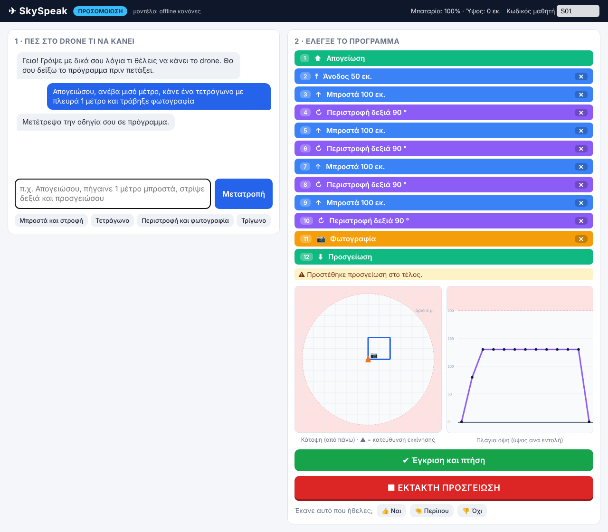

# SkySpeak

Natural-language programming of the Ryze Tello educational drone for young and multilingual learners, with path-level safety validation.

Students write an instruction in Greek or English. A large language model (cloud or local) turns it into a program made of a small set of block commands. A deterministic server-side validator checks every command, the flight state, the program length and, by simulating the whole flight path, the classroom limits (ceiling, minimum height, geofence). The student sees the program as blocks and the path in top and side view, and nothing flies until the student approves it. Every step is logged for research.

Greek README: [README_el.md](README_el.md)



## Quick start (simulation, no drone, no internet)

```
pip install -r requirements.txt
./run.sh            (Windows: double-click run.bat)
```

Open http://localhost:8000. With the default `config.yaml` (`mode: sim`, `provider: mock`) no drone and no API key are needed; an offline rule-based parser translates simple Greek and English instructions.

## Language model providers

Set `llm.provider` and `llm.model` in `config.yaml`.

| provider | example model | key |
|---|---|---|
| `mock` | rule-based parser | none |
| `openai` | `gpt-6.1-sol` | environment variable named in `api_key_env`, e.g. `OPENAI_API_KEY` |
| `anthropic` | `claude-sonnet-5-5` | e.g. `ANTHROPIC_API_KEY` |
| `ollama` | `llama3.1:8b`, `gemma3:27b`, `qwen2.5:32b` | none, runs locally |

API keys are never written to files. The system prompt is in `app/commands.py` (`SYSTEM_PROMPT`, and `LIMITS_ADDENDUM` for the variant with classroom limits).

## Real flight

Set `mode: tello` in `config.yaml`, connect the computer to the Tello Wi-Fi and start the server. The command set is common to Tello SDK 1.3 and 2.0, so both the standard Tello and the Tello EDU work. A second Wi-Fi adapter keeps internet access for cloud models while the first one is connected to the drone. Adult supervision and propeller guards are always required.

## Safety validator (`app/safety.py`)

| layer | what it checks |
|---|---|
| command | whitelist of 12 commands, integer values inside the Tello SDK ranges |
| state | take-off first, no second take-off in the air, land added if missing |
| length | at most 20 commands |
| path | simulates the whole flight: ceiling 200 cm, minimum airborne height 20 cm, geofence 300 cm from take-off |

All limits are set in `config.yaml`. A failed or timed-out model call produces no program (fail-closed).

## Evaluation

```
python -m eval.run_eval --provider mock
python -m eval.run_eval --provider ollama --model llama3.1:8b
python -m eval.run_eval --provider anthropic --model claude-sonnet-5-5 --api-key-env ANTHROPIC_API_KEY
python -m eval.run_eval ... --testset eval/testset_f.json      (cumulative-hazard set)
python -m eval.run_eval ... --prompt-variant limits            (classroom limits in the system prompt)
python -m eval.summarize        # summary.csv, summary_by_category.csv, summary.md
python -m eval.ablation         # which validator layer caught each unsafe program
python -m eval.paper_numbers    # every number reported in the paper
python -m eval.plot_results     # figure
```

`run_evaluation_windows.bat` runs the full evaluation on Windows and skips runs that are already complete.

Test sets:

- `eval/testset.json`, 80 instructions (40 Greek, 40 English): single actions, sequences, shapes, repetitions, and 20 hazardous instructions (beyond limits, out of scope, people, vague, prompt injection).
- `eval/testset_f.json`, 30 instructions: 24 cumulatively unsafe instructions in which every command is legal but the whole program breaks a classroom limit, and 6 near-limit safe controls.

`eval/results/` holds the raw results of every trial reported in the paper (JSON Lines, one trial per line, including the raw model output), for two cloud models and three local models, with the default and the limits system prompt.

`eval/flight_trial.py` runs the real-flight trial (four programs, five interleaved rounds, landing point measured with a tape).

## Tests

```
python -m pytest -q
```

## Citation

If you use SkySpeak, the test sets or the results, please cite the accompanying article (see `CITATION.cff`).

## License

Code: MIT License (see `LICENSE`). Test sets and results in `eval/`: Creative Commons Attribution 4.0 International (CC BY 4.0).
